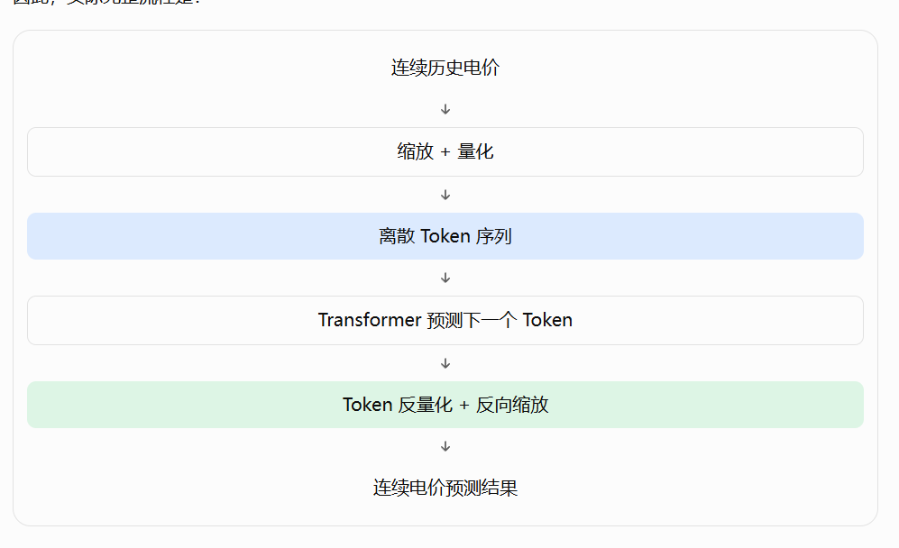

# Chronos：时间序列基础模型

> Chronos 是 Amazon 开发的一组时间序列基础模型（Time Series Foundation Models，TSFMs）。它们可以在没有针对当前数据集重新训练的情况下，直接对负荷、电价、销量、交通流量等序列进行零样本预测，并提供概率预测结果。
>
> 本文按 Chronos-T5、Chronos-Bolt 和 Chronos-2 的输入表示、预测方式与适用场景梳理其差异。模型版本、参数和接口可能随官方仓库更新，使用时应以[官方仓库](https://github.com/amazon-science/chronos-forecasting)和对应模型卡为准。

## 1. 三个主要版本

| 版本 | 首次发布 | 核心结构 | 输入与预测方式 | 主要特点 |
| --- | --- | --- | --- | --- |
| **Chronos-T5** | 2024 年 3 月 | T5 Encoder–Decoder | 连续值缩放、量化为离散 token，再自回归生成未来 token | 概率预测直观，但逐 token 解码速度较慢 |
| **Chronos-Bolt** | 2024 年 11 月 | 基于 T5 的 patch 模型 | 将历史值组织成 patch，一次前向传播直接输出未来多个时间步的分位数 | 比同规模原始 Chronos 更快、更省显存，适合批量推理 |
| **Chronos-2** | 2025 年 10 月 | 受 T5 启发的 encoder-only Transformer | 用连续值 patch 表示历史目标、相关序列和协变量，直接输出多步分位数 | 在同一模型中支持单变量、多变量和协变量辅助预测 |

可以先记住这个区别：

- **Chronos-T5**：把数值序列量化成 token，像语言模型一样逐步生成。
- **Chronos-Bolt**：把数值组织成 patch，直接预测整个未来区间。
- **Chronos-2**：在 patch 预测的基础上，用 group attention 建模相关序列和协变量之间的关系。

三个版本都可以输出预测分布，但表示方式、解码方式和可使用的输入信息不同。

## 2. Chronos-T5：把时间序列当作 token 序列

### 2.1 整体架构

Chronos-T5 使用经典的 T5 Encoder–Decoder Transformer。这里的“T5”指网络结构的来源，并不表示它是用于聊天的语言模型。



预测流程可以概括为：

```text
历史数值 → 缩放 → 量化为 token → Encoder–Decoder 自回归预测 → 反量化 → 连续值预测
```

### 2.2 数值如何转换成 token

假设有一段电价序列：

\[
x=[100,\ 105,\ 110,\ 108,\ 115]
\]

Chronos 会先根据序列的尺度进行稳健缩放，再把缩放后的连续值映射到预先定义的离散 bin。为了说明原理，假设使用下面的简化规则：

| 数值区间 | 示意 token |
| --- | --- |
| 90–99 | A |
| 100–109 | B |
| 110–119 | C |
| 120–129 | D |
| 130–139 | E |

例如，序列 `100, 110, 120, 115, 130` 会被表示为：

```text
B → C → D → C → E
```

上面的区间和字母仅用于说明。真实模型使用数字 token ID、更细的量化空间以及模型内部的缩放规则；token 并不直接等同于一个固定的原始价格区间。

### 2.3 自回归预测未来 token

给定历史 token `B, C, D, C, E`，Decoder 会输出下一个 token 的概率分布。例如：

| 候选 token | 示意概率 |
| --- | ---: |
| C | 10% |
| D | 20% |
| E | 50% |
| F | 20% |

模型可以选择最大概率 token，也可以按概率采样。连续预测不是简单的“取概率最高 token 对应区间的中心”：实际推理通常会生成多条样本，再将样本反变换回原始尺度，从样本集合计算中位数、分位数和预测区间。

### 2.4 优点与局限

- 优点：训练目标简单，天然产生预测样本，便于构造完整的预测分布。
- 局限：未来值需要逐个 token 生成，预测步数越长，推理延迟通常越高；离散化也会带来量化误差。

## 3. Chronos-Bolt：用 patch 和直接多步预测提速

Chronos-Bolt 并不是简单缩小 Chronos-T5，而是改变了输入表示和输出方式。它仍沿用 T5 风格的编码器—解码器骨干，但用 patch 表示历史序列，并通过预测头一次输出未来多个时间步的分位数。

### 3.1 什么是 patch

若历史序列有 16 个点、每 4 个点组成一个 patch：

```text
原始序列：x1  x2  x3  x4  x5  x6  x7  x8  x9  x10 x11 x12 x13 x14 x15 x16
Patch：   [x1 x2 x3 x4]    [x5 x6 x7 x8]    [x9 x10 x11 x12]    [x13 x14 x15 x16]
```

Transformer 需要处理的时间位置从 16 个减少为 4 个，局部变化也可以在一个 patch 内集中编码。实际 patch 大小由模型配置决定。

### 3.2 预测流程

```text
历史序列 → 缩放与 patch 化 → T5 编码器—解码器 → 预测头 → 未来多个时间步的分位数
```

原始 Chronos 更接近：

\[
\hat{x}_{t+1}\rightarrow\hat{x}_{t+2}\rightarrow\cdots\rightarrow\hat{x}_{t+H}
\]

Chronos-Bolt 则直接输出：

\[
[\hat{x}_{t+1},\hat{x}_{t+2},\ldots,\hat{x}_{t+H}]
\]

这称为**直接多步预测（direct multi-step forecasting）**。它减少了循环解码，因此在批量场景下通常更快、更省显存。

### 3.3 分位数预测

模型可以同时输出多个分位数，例如：

- **P10**：较低的预测水平；
- **P50**：中位数预测，常作为点预测；
- **P90**：较高的预测水平。

由 P10 和 P90 可以构造预测区间。分位数不是“发生概率为 10% 或 90%”，而是满足覆盖率定义的条件分位点。实际使用时应检查区间覆盖率和宽度，而不能只看 P50 的误差。

## 4. Chronos-2：面向多变量和协变量的统一模型

Chronos-2 于 2025 年 10 月发布，是约 1.2 亿参数的 encoder-only 时间序列基础模型。官方模型卡将它定位为支持**单变量、多变量和协变量辅助预测**的统一模型。

### 4.1 输入与输出

Chronos-2 的输入可以包含：

- 目标序列（需要预测的变量）；
- 过去协变量（预测时刻之前可观测的相关变量）；
- 已知未来协变量（预测区间内已经知道的日历、计划或天气预报等变量）；
- 缺失值掩码和序列分组信息。

模型对输入进行缩放和 patch 化，把连续值编码成向量表示，而不是先转成离散 token，然后通过 encoder 处理历史上下文，并由预测头输出未来多个时间步的分位数。

一个简化流程如下：

```text
目标序列 + 协变量
        ↓
缩放、时间索引、缺失掩码、patch 化
        ↓
Encoder Transformer
  ├─ 时间注意力（同一序列的不同时间片段）
  ├─ 分组注意力（相关序列之间）
  └─ 前馈网络
        ↓
多步分位数预测
```

具体的嵌入和注意力实现应以官方代码为准；不要把上图理解成模型内部唯一的计算顺序。

### 4.2 时间注意力

时间注意力用于学习同一条序列不同历史片段之间的关系，例如：

- 昨天或上周同一时刻的值；
- 最近几个小时的变化；
- 日周期、周周期和更长趋势；
- 突变、峰值和局部模式。

它回答的是：“这条序列过去哪些时间片段对未来最有帮助？”

### 4.3 分组注意力

假设预测电价，同时提供负荷、光伏出力和另一个区域的价格。分组注意力允许同一预测任务中的相关序列在对应 patch 位置交换信息，从而利用变量间的统计关联。

它学习的是相关性，不是因果关系。例如，模型可能利用“负荷上升通常伴随电价上升”的模式，但这不能证明负荷上升必然导致电价上涨。

分组也不是把所有样本无条件混在一起。使用接口时，需要按照任务定义提供相应的序列分组信息（例如 `group_ids`）；不同组之间通常不会交换这部分信息。

### 4.4 为什么使用 encoder-only

Chronos-T5 和 Chronos-Bolt 都保留了 Encoder–Decoder 形式；Chronos-2 则不再依赖 Decoder 逐个生成未来 token。它把历史目标、协变量和用于预测的未来位置组织成输入表示，Encoder 一次处理整个上下文，再由预测头读取未来位置的隐藏表示并输出多步分位数。

因此，**encoder-only 不等于只能理解历史**。关键在于输入如何表示预测位置，以及预测头如何把隐藏表示映射为未来值。

### 4.5 三个版本的对比

| 对比项 | Chronos-T5 | Chronos-Bolt | Chronos-2 |
| --- | --- | --- | --- |
| 主体架构 | Encoder–Decoder | T5 风格 Encoder–Decoder | Encoder-only |
| 数值表示 | 离散 token | patch 表示 | 连续值 patch 向量 |
| 未来生成 | 自回归生成 token | 直接多步输出 | 直接多步输出 |
| 概率输出 | 样本/采样分布 | 多步分位数 | 多步分位数 |
| 多序列联合建模 | 非原生重点 | 非原生重点 | 原生支持 group attention |
| 协变量 | 能力有限，取决于接口 | 主要面向单序列预测 | 支持过去和已知未来协变量 |
| 典型取舍 | 表达直观、推理慢 | 速度快、批量友好 | 输入更丰富、建模关系更强 |

## 5. 训练方式的变化

### 5.1 Chronos-T5

使用真实公开时间序列和基于高斯过程生成的合成序列。训练前将数值缩放并量化为 token，然后用交叉熵训练下一 token 预测。模型学习的是时间序列模式的统计“语言”，而不是某个行业的固定公式。

### 5.2 Chronos-Bolt

训练目标转向 patch 编码和多步分位数预测，避免为每个未来时间步执行一次自回归解码。官方介绍称其训练数据规模接近 1000 亿个时间序列观测值；具体数据组成和模型版本应以论文和模型卡为准。

### 5.3 Chronos-2

除了真实数据，Chronos-2 还使用大规模合成数据构造多变量依赖结构，使模型在预训练阶段学习如何联合使用目标序列、相关序列和协变量。这里的合成数据不只是“更多单变量序列”，还包括带有不同关联模式的多变量预测任务。

## 6. 如何使用与如何选型

### 6.1 选择建议

- 只需要单变量零样本预测、希望获得样本级预测分布：可以从 **Chronos-T5** 开始。
- 更关注推理速度、批量预测和标准分位数输出：优先考虑 **Chronos-Bolt**。
- 需要多个相关序列、过去协变量或已知未来协变量：优先考虑 **Chronos-2**。

选择模型时还要结合预测频率、历史窗口、预测步长、CPU/GPU 资源和评估指标。基础模型的零样本效果并不保证在每个数据集上都优于专门训练的模型，生产使用前应与季节性朴素法、ARIMA、树模型或任务专用神经网络进行滚动回测。

### 6.2 一个最小化的推理示例

官方 Python 包为 `chronos-forecasting`。下面示例展示 Chronos-Bolt 的基本调用方式；模型 ID、数据格式和设备参数应以当前版本文档为准：

```python
import torch
from chronos import BaseChronosPipeline

pipeline = BaseChronosPipeline.from_pretrained(
    "amazon/chronos-bolt-small",
    device_map="cuda" if torch.cuda.is_available() else "cpu",
    torch_dtype=torch.bfloat16 if torch.cuda.is_available() else torch.float32,
)

context = torch.tensor([100.0, 105.0, 110.0, 108.0, 115.0])
quantiles, mean = pipeline.predict_quantiles(
    context,
    prediction_length=3,
    quantile_levels=[0.1, 0.5, 0.9],
)
```

Chronos-2 的多变量和协变量输入需要使用其专用 pipeline 数据结构，不能把多列数据简单拼成一条序列。调用前应确认每条序列的频率、时间对齐方式、缺失值处理和已知未来信息是否符合接口要求。

### 6.3 评估概率预测

除了 MAE、RMSE、MAPE 等点预测指标，还应评估概率预测：

- 分位数损失（quantile loss / pinball loss）；
- 区间覆盖率（例如名义 80% 区间实际覆盖率）；
- 区间宽度与覆盖率的平衡；
- 不同预测步长和不同时间段的稳定性。

## 7. 实际使用时的注意事项

1. **先处理尺度和异常值。** 模型内部有缩放机制，但极端异常、单位混乱或大量缺失仍可能导致不稳定预测。
2. **明确协变量可用时间。** 只有在预测时确实已知的变量才能作为未来协变量；把事后才知道的真实值放入未来输入会造成数据泄漏。
3. **保持时间对齐。** 目标、协变量和时间戳的频率、时区、缺失位置必须一致。
4. **不要把相关性解释成因果性。** Group attention 能利用统计关系，但不会自动完成因果识别。
5. **做滚动回测。** 零样本预测是很好的起点，但模型选择、阈值设置和上线前的性能判断都应基于与实际部署一致的时间切分。
6. **记录模型版本。** Hugging Face 权重、Python 包和接口会更新，生产环境应固定模型 revision 和依赖版本。

## 8. 参考资料

- [Chronos 官方代码仓库](https://github.com/amazon-science/chronos-forecasting)
- [Chronos 论文：Pretrained Models for Time Series Forecasting](https://arxiv.org/abs/2403.07815)
- [Chronos-2 技术报告](https://arxiv.org/abs/2510.15821)
- [Chronos-2 模型卡](https://huggingface.co/amazon/chronos-2)
- [Chronos 官方 Hugging Face 模型列表](https://huggingface.co/amazon)
